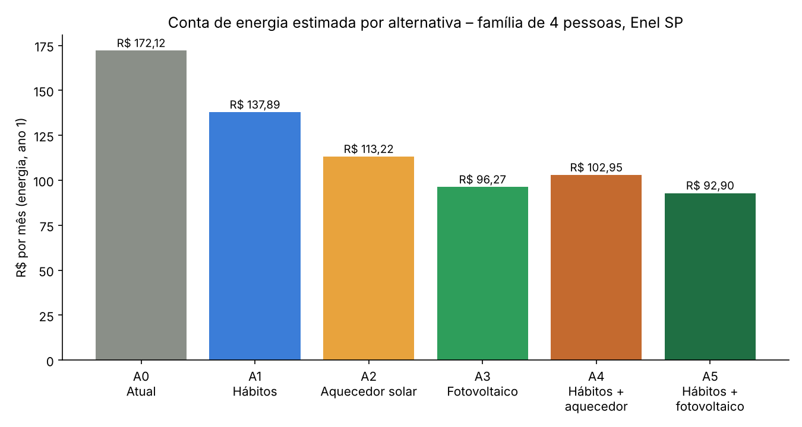
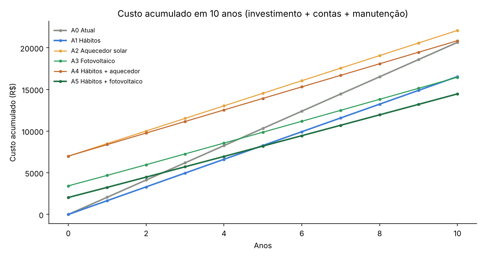
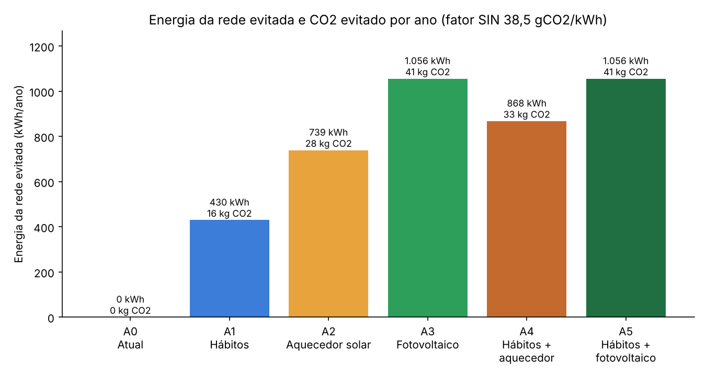

# Análise energética – Citizen Assist AI (módulo de energia)

> Documento gerado automaticamente por `analise/gerar_analise.py` a partir de `dados/parametros.json`.
> Os mesmos cálculos alimentam as respostas do assistente (`citizen_energy/`).

## 1. Necessidade analisada e período de referência

* **Público:** famílias de baixa e média renda da Região Metropolitana de São Paulo (área da Enel SP), que usam chuveiro elétrico.
* **Necessidade energética:** aquecer a água do banho, o maior consumo individual de uma casa típica.
* **Família de referência:** 4 moradores, 4 banhos/dia de 8 min, chuveiro de 5500 W, consumo total de 180 kWh/mês (próximo do consumo residencial médio nacional de 181,8 kWh/mês [R6]), ligação bifásica.
* **Período comum de comparação:** 12 meses (economia anual) e horizonte de **10 anos** (custo total acumulado). Cenário base com tarifa constante; sensibilidade com reajuste de 5% ao ano.

## 2. Conceitos e fórmulas

* **Potência (W)** é a taxa de uso de energia; **energia (kWh)** = potência (kW) × tempo (h).
* Chuveiro: E = 5,5 kW × (4 × 8 min ÷ 60) h/dia × 30 dias = **88,0 kWh/mês** (49% do consumo da casa). O mesmo cenário aparece em simulação pública baseada em dados Procel/INMETRO [R7].
* **Preço final do kWh** = tarifa sem tributos ÷ (1 − PIS/COFINS − ICMS), cálculo "por dentro" usado na fatura.
* **Fotovoltaico:** geração mensal = kWp × HSP × 30 × PR = kWp × 4,6 × 30 × 0,78 = **107,6 kWh por kWp/mês**.
* **Aquecedor solar:** energia elétrica do chuveiro × (1 − fração solar).
* **Retorno simples (payback)** = investimento ÷ (economia anual − manutenção).
* **Emissões** = kWh evitados × fator de emissão do SIN (0,0385 kgCO2/kWh [R13]).

## 3. Tarifa usada (Enel SP, B1 residencial)

| Etapa | Valor |
|---|---|
| TUSD + TE vigentes até jul/2026 (sem tributos) [R2] | R$ 0,73/kWh |
| Reajuste residencial ANEEL 2026 (+9,02%) [R1] → **estimado** | R$ 0,79/kWh |
| + bandeira média de 2026 (amarela de maio a setembro) [R3] | R$ 0,80/kWh |
| Preço final com PIS/COFINS (4,5%) e ICMS de 12% (91–200 kWh) | **R$ 0,96/kWh** |
| Preço final até 90 kWh (ICMS isento) / acima de 200 kWh (ICMS 18%) | R$ 0,84 / R$ 1,03 por kWh |
| Conta de energia da família de referência (180 kWh) | **R$ 172,12/mês** (sem CIP/COSIP) |
| Mesma família com Tarifa Social (80 kWh gratuitos, Lei 15.235/2025 [R5]) | R$ 95,62/mês |

A tarifa pós-reajuste é **estimada** aplicando o efeito médio residencial às componentes TE e TUSD; a alíquota de ICMS por faixa e o PIS/COFINS efetivo foram observados em faturas reais de 2026 [R2].

## 4. Alternativas comparadas (mesma necessidade, mesmo período)

| Alternativa | Renovável | Chuveiro (kWh/mês) | Consumo da casa (kWh/mês) | Conta energia (R$/mês, ano 1) | Economia (R$/ano) | Investimento | Retorno simples | Custo total 10 anos (tarifa constante) | Custo total 10 anos (+5% a.a.) | CO2 evitado (kg/ano) |
|---|---|---|---|---|---|---|---|---|---|---|
| **A0** Situação atual (chuveiro elétrico) <small>4 banhos/dia de 8 min a 5500 W</small> | não | 88,0 | 180,0 | R$ 172,12 | R$ 0,00 | R$ 0,00 | imediato | R$ 20.654,39 | R$ 25.978,87 | 0,0 |
| **A1** Eficiência: banho mais curto + posição verão <small>banho de 6 min e posição verão 6 meses/ano</small> | não | 52,2 | 144,2 | R$ 137,89 | R$ 410,79 | R$ 0,00 | imediato | R$ 16.546,46 | R$ 20.811,96 | 16,5 |
| **A2** Aquecedor solar de água – solar térmico <small>sol fornece ~70% do aquecimento; chuveiro fica como apoio</small> | sim | 26,4 | 118,4 | R$ 113,22 | R$ 706,84 | R$ 7.000,00 | 12,6 anos | R$ 22.086,00 | R$ 25.588,32 | 28,5 |
| **A3** Painéis fotovoltaicos – solar elétrico <small>0.82 kWp (~2 módulos de 550 Wp), geração ~88 kWh/mês</small> | sim | 88,0 | 180,0 | R$ 96,27 | R$ 910,18 | R$ 3.433,67 | 4,2 anos | R$ 16.466,56 | R$ 19.601,48 | 40,7 |
| **A4** Combinação: hábitos (A1) + aquecedor solar (A2) <small>menos tempo de banho e água pré-aquecida pelo sol</small> | sim | 15,7 | 107,7 | R$ 102,95 | R$ 830,08 | R$ 7.000,00 | 10,3 anos | R$ 20.853,62 | R$ 24.038,25 | 33,4 |
| **A5** Combinação: hábitos (A1) + fotovoltaico menor (A3) <small>0.48 kWp, dimensionado para o consumo do chuveiro já reduzido (52 kWh/mês)</small> | sim | 52,2 | 144,2 | R$ 92,90 | R$ 950,69 | R$ 2.036,79 | 2,4 anos | R$ 14.469,14 | R$ 17.435,83 | 40,7 |

### Mesma comparação para uma família com Tarifa Social

| Alternativa | Renovável | Chuveiro (kWh/mês) | Consumo da casa (kWh/mês) | Conta energia (R$/mês, ano 1) | Economia (R$/ano) | Investimento | Retorno simples | Custo total 10 anos (tarifa constante) | Custo total 10 anos (+5% a.a.) | CO2 evitado (kg/ano) |
|---|---|---|---|---|---|---|---|---|---|---|
| **A0** Situação atual (chuveiro elétrico) <small>4 banhos/dia de 8 min a 5500 W</small> | não | 88,0 | 180,0 | R$ 95,62 | R$ 0,00 | R$ 0,00 | imediato | R$ 11.474,66 | R$ 14.432,71 | 0,0 |
| **A1** Eficiência: banho mais curto + posição verão <small>banho de 6 min e posição verão 6 meses/ano</small> | não | 52,2 | 144,2 | R$ 61,39 | R$ 410,79 | R$ 0,00 | imediato | R$ 7.366,73 | R$ 9.265,80 | 16,5 |
| **A2** Aquecedor solar de água – solar térmico <small>sol fornece ~70% do aquecimento; chuveiro fica como apoio</small> | sim | 26,4 | 118,4 | R$ 36,72 | R$ 706,84 | R$ 7.000,00 | 12,6 anos | R$ 12.906,27 | R$ 14.042,16 | 28,5 |
| **A3** Painéis fotovoltaicos – solar elétrico <small>0.82 kWp (~2 módulos de 550 Wp), geração ~88 kWh/mês</small> | sim | 88,0 | 180,0 | R$ 19,77 | R$ 910,18 | R$ 3.433,67 | 4,2 anos | R$ 7.286,83 | R$ 8.055,32 | 40,7 |
| **A4** Combinação: hábitos (A1) + aquecedor solar (A2) <small>menos tempo de banho e água pré-aquecida pelo sol</small> | sim | 15,7 | 107,7 | R$ 26,45 | R$ 830,08 | R$ 7.000,00 | 10,3 anos | R$ 11.673,89 | R$ 12.492,09 | 33,4 |
| **A5** Combinação: hábitos (A1) + fotovoltaico menor (A3) <small>0.48 kWp, dimensionado para o consumo do chuveiro já reduzido (52 kWh/mês)</small> | sim | 52,2 | 144,2 | R$ 16,40 | R$ 950,69 | R$ 2.036,79 | 2,4 anos | R$ 5.289,41 | R$ 5.889,66 | 40,7 |

### Viabilidade e impactos ambientais

| Alternativa | Viabilidade | Impacto ambiental | Limitações |
|---|---|---|---|
| A0 | Já é a situação da família. | Toda a energia vem da rede; o chuveiro concentra consumo no horário de pico (18h-21h), quando o sistema mais usa térmicas. | Maior gasto mensal; potência alta pode sobrecarregar instalações antigas. |
| A1 | Alta: não exige compra, obra nem ser dono do imóvel. Depende de adesão de todos os moradores. | Reduz energia e também água. Sem resíduos ou fabricação de equipamentos. | Economia depende do hábito ser mantido; conforto menor em dias frios na posição verão. |
| A2 | Média: exige telhado com sol (face norte), caixa d'água elevada, espaço para o reservatório e autorização do proprietário. Investimento inicial alto para baixa renda; vale procurar programas habitacionais e financiamentos. | Usa energia renovável direto como calor (eficiência maior que converter sol em eletricidade). Fabricação usa vidro, cobre/alumínio e isolamento; vida útil longa. | Em dias nublados seguidos o chuveiro elétrico ainda é usado. Requer manutenção e instalação por profissional. |
| A3 | Média: exige telhado próprio com sol, homologação na distribuidora e dinheiro (ou crédito) para o investimento. Como os banhos acontecem sem sol, ~70% da geração é injetada na rede e paga parte do Fio B, que sobe ano a ano (Lei 14.300). A conta nunca fica abaixo do custo de disponibilidade. | Energia renovável sem emissão na operação; módulos e inversor exigem descarte/reciclagem adequados no fim da vida útil (~25 anos). | Resultado muito sensível ao preço por Wp de sistemas pequenos e ao valor do Fio B (estimado). Inquilinos normalmente não podem instalar. Na Tarifa Social, a economia só se mantém enquanto o consumo líquido ficar acima dos 80 kWh gratuitos. |
| A4 | Média (mesmas exigências do aquecedor solar), mas com o menor consumo de eletricidade da casa entre as opções. | Menor uso de energia da rede entre as opções; soma os ganhos de hábito e de fonte renovável. | Mesmas do aquecedor solar; o ganho extra do hábito é menor porque o sol já aquece boa parte da água. |
| A5 | Média (mesmas exigências do fotovoltaico), com investimento menor porque o consumo já foi reduzido pelos hábitos. | Soma a redução de consumo com geração renovável. | Mesmas do fotovoltaico; se os hábitos não forem mantidos, o sistema fica subdimensionado. |

## 5. Análise de sensibilidade

As premissas mais incertas foram variadas uma de cada vez (demais valores no cenário base):

| Variável | Valor | Alternativa | Investimento | Economia ano 1 | Retorno | Custo 10 anos | Custo 10 anos de A1 (hábitos) |
|---|---|---|---|---|---|---|---|
| FV: custo por Wp (R$) | 3,40 | A3 | R$ 2.779,64 | R$ 910,18 | 3,4 anos | R$ 15.812,53 | R$ 16.546,46 |
| FV: custo por Wp (R$) | 4,20 | A3 | R$ 3.433,67 | R$ 910,18 | 4,2 anos | R$ 16.466,56 | R$ 16.546,46 |
| FV: custo por Wp (R$) | 5,50 | A3 | R$ 4.496,47 | R$ 910,18 | 5,5 anos | R$ 17.529,37 | R$ 16.546,46 |
| FV: custo por Wp (R$) | 7,00 | A3 | R$ 5.722,78 | R$ 910,18 | 7,1 anos | R$ 18.755,68 | R$ 16.546,46 |
| FV: Fio B (R$/kWh) | 0,10 | A3 | R$ 3.433,67 | R$ 943,38 | 4,1 anos | R$ 16.049,23 | R$ 16.546,46 |
| FV: Fio B (R$/kWh) | 0,15 | A3 | R$ 3.433,67 | R$ 910,18 | 4,2 anos | R$ 16.466,56 | R$ 16.546,46 |
| FV: Fio B (R$/kWh) | 0,25 | A3 | R$ 3.433,67 | R$ 843,78 | 4,6 anos | R$ 17.301,24 | R$ 16.546,46 |
| FV: autoconsumo simultâneo | 10% | A3 | R$ 3.433,67 | R$ 881,72 | 4,4 anos | R$ 16.824,28 | R$ 16.546,46 |
| FV: autoconsumo simultâneo | 30% | A3 | R$ 3.433,67 | R$ 910,18 | 4,2 anos | R$ 16.466,56 | R$ 16.546,46 |
| FV: autoconsumo simultâneo | 50% | A3 | R$ 3.433,67 | R$ 938,63 | 4,1 anos | R$ 16.108,85 | R$ 16.546,46 |
| Aquecedor: investimento (R$) | 5.000 | A2 | R$ 5.000,00 | R$ 706,84 | 9,0 anos | R$ 20.086,00 | R$ 16.546,46 |
| Aquecedor: investimento (R$) | 7.000 | A2 | R$ 7.000,00 | R$ 706,84 | 12,6 anos | R$ 22.086,00 | R$ 16.546,46 |
| Aquecedor: investimento (R$) | 9.000 | A2 | R$ 9.000,00 | R$ 706,84 | 16,2 anos | R$ 24.086,00 | R$ 16.546,46 |
| Aquecedor: fração solar | 60% | A2 | R$ 7.000,00 | R$ 605,86 | 15,4 anos | R$ 23.095,77 | R$ 16.546,46 |
| Aquecedor: fração solar | 70% | A2 | R$ 7.000,00 | R$ 706,84 | 12,6 anos | R$ 22.086,00 | R$ 16.546,46 |
| Aquecedor: fração solar | 80% | A2 | R$ 7.000,00 | R$ 807,82 | 10,6 anos | R$ 21.076,23 | R$ 16.546,46 |
| Moradores (1 banho de 8 min cada) | 2 (casa 136 kWh/mês) | A2 | R$ 7.000,00 | R$ 353,42 | 34,4 anos | R$ 20.571,34 | R$ 13.551,58 |
| Moradores (1 banho de 8 min cada) | 2 (casa 136 kWh/mês) | A3 | R$ 1.716,83 | R$ 455,09 | 4,8 anos | R$ 14.011,63 | R$ 13.551,58 |
| Moradores (1 banho de 8 min cada) | 4 (casa 180 kWh/mês) | A2 | R$ 7.000,00 | R$ 706,84 | 12,6 anos | R$ 22.086,00 | R$ 16.546,46 |
| Moradores (1 banho de 8 min cada) | 4 (casa 180 kWh/mês) | A3 | R$ 3.433,67 | R$ 910,18 | 4,2 anos | R$ 16.466,56 | R$ 16.546,46 |
| Moradores (1 banho de 8 min cada) | 6 (casa 224 kWh/mês) | A2 | R$ 7.000,00 | R$ 1.259,25 | 6,3 anos | R$ 23.600,66 | R$ 19.541,35 |
| Moradores (1 banho de 8 min cada) | 6 (casa 224 kWh/mês) | A3 | R$ 5.150,50 | R$ 1.564,26 | 3,5 anos | R$ 18.921,50 | R$ 19.541,35 |
| Tarifa Social (CadÚnico) | sim | A2 | R$ 7.000,00 | R$ 706,84 | 12,6 anos | R$ 12.906,27 | R$ 7.366,73 |
| Tarifa Social (CadÚnico) | sim | A3 | R$ 3.433,67 | R$ 910,18 | 4,2 anos | R$ 7.286,83 | R$ 7.366,73 |

## 6. Conclusões (e como viram respostas do assistente)

1. **Hábitos primeiro (A1).** Banho de 6 min e posição verão por 6 meses reduzem o chuveiro de 88,0 para 52,2 kWh/mês, economizando ~R$ 410,79/ano **sem investimento**. Para famílias na Tarifa Social, a economia em reais é a mesma, porque o consumo continua acima dos 80 kWh gratuitos.
2. **Entre as renováveis, A3 (painéis fotovoltaicos – solar elétrico) tem menor custo em 10 anos** (R$ 16.466,56, retorno 4,2 anos) do que A2 (R$ 22.086,00, retorno 12,6 anos), no cenário base.
3. **O resultado depende de premissas incertas.** Se o fotovoltaico pequeno custar R$ 7,00/Wp, o retorno de A3 passa a 7,1 anos; se o aquecedor solar custar R$ 5.000, o retorno de A2 cai para 9,0 anos. Por isso o assistente sempre pede orçamentos reais e mostra as premissas.
4. **Melhor combinação: A5 (hábitos (A1) + fotovoltaico menor (A3))**, com economia de ~R$ 950,69/ano. Reduzir o consumo antes diminui o tamanho e o preço do equipamento.
5. **Investir ou só mudar hábitos?** Em 10 anos, a melhor renovável isolada custa R$ 16.466,56 contra R$ 16.546,46 dos hábitos gratuitos (diferença de R$ 79,90): investimento e manutenção consomem boa parte da economia extra no horizonte de 10 anos. O investimento se destaca quando combinado com hábitos (A5) e ao longo da vida útil completa dos equipamentos (15 a 25 anos). Para quem não tem capital, os hábitos entregam resultado parecido sem risco.
   **Viabilidade social:** as opções renováveis exigem casa própria, telhado adequado e capital ou crédito – barreiras reais para o público. Na Tarifa Social, a economia em reais é a mesma enquanto o consumo líquido continuar acima dos 80 kWh gratuitos; abaixo disso, reduzir mais não diminui a conta.
6. **Impacto ambiental:** com a matriz elétrica brasileira muito renovável, o CO2 evitado por casa é pequeno (até 41 kg/ano). Os ganhos ambientais mais relevantes são reduzir a demanda no horário de pico (18h–21h), quando o sistema recorre a térmicas, e economizar água com banhos curtos. Fabricação e descarte de módulos, inversores e coletores devem ser considerados.

## 7. Parâmetros, origem e tipo de dado

Tipos: **real** = publicado em fonte verificável; **estimado** = calculado a partir de dado real com hipótese explícita; **premissa** = hipótese da equipe, ajustável pelo usuário.

| Parâmetro | Valor | Unidade | Tipo | Fonte | Observação |
|---|---|---|---|---|---|
| tarifa.tusd_pre_reajuste | 0.43244 | R$/kWh (sem tributos) | real | R2 | TUSD B1 residencial Enel SP vigente de jul/2025 a jul/2026, conforme faturas B1 publicadas. |
| tarifa.te_pre_reajuste | 0.29274 | R$/kWh (sem tributos) | real | R2 | TE B1 residencial Enel SP vigente de jul/2025 a jul/2026, conforme faturas B1 publicadas. |
| tarifa.reajuste_residencial_2026 | 0.0902 | fração | real | R1 | Efeito médio do reajuste ANEEL 2026 para o segmento residencial da Enel SP, vigente desde 04/07/2026. |
| tarifa.pis_cofins_efetivo | 0.045 | fração do preço final | estimado | R2 | Alíquota efetiva varia mês a mês (cerca de 4% a 6% nas faturas observadas). Usamos 4,5%. |
| tarifa.icms_faixas | [[90, 0.0], [200, 0.12], [999999, 0.18]] | [limite kWh/mês, alíquota] | real | R2 | SP: isento até 90 kWh, 12% de 91 a 200 kWh e 18% acima de 200 kWh, conforme faturas observadas. A alíquota incide sobre todo o consumo do mês. |
| tarifa.bandeira_media_2026 | 0.007854 | R$/kWh (sem tributos) | estimado | R3 | Bandeira amarela (R$ 1,885 a cada 100 kWh) de maio a setembro/2026 e verde nos demais meses: 0,01885 x 5/12. |
| tarifa.custo_disponibilidade_kwh | {monofasico: 30, bifasico: 50, trifasico: 100} | kWh/mês | real | R4 | Consumo mínimo faturado (REN ANEEL 1.000/2021). Relevante para geração solar: a conta não fica abaixo disso. |
| tarifa_social.limite_gratuidade_kwh | 80 | kWh/mês | real | R5 | Lei 15.235/2025: desconto de 100% até 80 kWh/mês para famílias do CadÚnico com renda per capita até 1/2 salário mínimo (e BPC). Acima de 80 kWh não há desconto. |
| tarifa_social.limite_desconto_social_kwh | 120 | kWh/mês | real | R5 | Famílias com renda per capita entre 1/2 e 1 salário mínimo: isenção das quotas da CDE até 120 kWh. O valor da CDE na tarifa não foi modelado. |
| consumo.consumo_residencial_medio_brasil | 181.8 | kWh/mês | real | R6 | Consumo residencial médio recorde da série EPE. Usado como ordem de grandeza da família de referência. |
| consumo.consumo_familia_referencia | 180 | kWh/mês | premissa | R6 | Família de 4 pessoas na Região Metropolitana de SP, próxima da média nacional. |
| consumo.outros_consumos_referencia | 92 | kWh/mês | premissa | R6 | Consumo da casa sem o chuveiro (180 - 88 kWh). Usado para estimar o total quando o usuário informa moradores/banho mas não o consumo da conta. |
| chuveiro.potencia_inverno_w | 5500 | W | real | R7 | Potência típica de chuveiro elétrico (faixa de mercado 4.400 a 7.700 W). |
| chuveiro.potencia_verao_w | 3200 | W | premissa | R7 | Potência típica da posição 'verão' de um chuveiro de 5.500 W. Conferir na etiqueta do aparelho. |
| chuveiro.banhos_por_dia | 4 | banhos/dia | premissa | - | 1 banho por morador, 4 moradores. |
| chuveiro.minutos_por_banho | 8 | min | premissa | R7 | Mesmo cenário usado em simulações públicas de consumo (4 banhos de 8 min/dia = 88 kWh/mês). |
| eficiencia.minutos_por_banho_meta | 6 | min | premissa | - | Meta de redução de 2 minutos por banho. |
| eficiencia.meses_posicao_verao | 6 | meses/ano | premissa | - | Posição verão de outubro a março. |
| eficiencia.investimento | 0 | R$ | premissa | - | Mudança de hábito, sem compra de equipamento. |
| aquecedor_solar.investimento | 7000 | R$ | estimado | R8 | Ponto médio da faixa de referência 2026 (R$ 5.000 a R$ 9.000) para sistema de ~300 L em casa já preparada. |
| aquecedor_solar.fracao_solar | 0.7 | fração da energia de aquecimento | premissa | R9 | Parcela do aquecimento suprida pelo sol ao longo do ano; o chuveiro elétrico fica como apoio em dias nublados. |
| aquecedor_solar.manutencao_anual | 150 | R$/ano | premissa | - | Limpeza de coletores e verificação do reservatório. |
| aquecedor_solar.vida_util_anos | 15 | anos | premissa | - | Vida útil conservadora para coletores e reservatório. |
| fotovoltaico.hsp_sao_paulo | 4.6 | kWh/m².dia (horas de sol pleno) | estimado | R10 | Faixa de 4,5 a 4,8 para a capital e Grande SP. Confirmar no SunData/CRESESB com as coordenadas do endereço. |
| fotovoltaico.performance_ratio | 0.78 | fração | premissa | - | Perdas de temperatura, sujeira, cabos e inversor. |
| fotovoltaico.potencia_modulo_wp | 550 | Wp | premissa | - | Módulo comercial comum. |
| fotovoltaico.custo_por_wp | 4.2 | R$/Wp instalado | estimado | R11 | Topo da faixa de 2026 (R$ 3,40 a R$ 4,20/Wp) porque sistemas muito pequenos custam mais por Wp. A média nacional (R$ 2,45/Wp) vale para sistemas maiores. |
| fotovoltaico.fracao_autoconsumo | 0.3 | fração da geração | premissa | - | Banhos ocorrem de manhã cedo e à noite: a maior parte da geração é injetada na rede. |
| fotovoltaico.fio_b | 0.15 | R$/kWh (sem tributos) | estimado | R12 | Valor do Fio B da Enel SP não localizado em fonte pública; estimado em ~19% da tarifa, proporção semelhante à de outra distribuidora paulista. Sensibilidade: 0,10 a 0,25. |
| fotovoltaico.fio_b_percentual_por_ano | {2026: 0.6, 2027: 0.75, 2028: 0.9, 2029: 1.0} | fração do Fio B não compensada | real | R12 | Lei 14.300/2022, art. 27. A regra a partir de 2029 depende de regulamentação; usamos 100% (cenário conservador). |
| fotovoltaico.degradacao_anual | 0.005 | fração/ano | premissa | - | Perda de rendimento típica dos módulos. |
| fotovoltaico.manutencao_anual | 100 | R$/ano | premissa | - | Limpeza dos módulos. |
| ambiental.fator_emissao_sin | 0.0385 | kgCO2/kWh | real | R13 | Fator médio anual do SIN em 2023 (38,5 kg/MWh, MCTI). Fatores mensais de 2025 ficaram entre 21,5 e 28,9 kg/MWh com nova metodologia. |
| cenarios.ano_inicio | 2026 | ano | premissa | - | Instalação/mudança em nov/2026. |
| cenarios.horizonte_anos | 10 | anos | premissa | - | Horizonte comum para comparar alternativas. |
| cenarios.reajuste_tarifa_sensibilidade | 0.05 | fração/ano | premissa | R1 | Cenário de sensibilidade com reajuste anual de 5%. O cenário base mantém a tarifa constante. |

## 8. Referências

* **[R1]** ANEEL aprova reajuste da Enel SP 2026: +9,02% no segmento residencial, vigente desde 04/07/2026. Gazeta SP / Canal Solar (com dados da ANEEL). Disponível em: <https://www.gazetasp.com.br/economia/aneel-aprova-reajuste-tarifa-conta-de-luz-enel-sao-paulo/>. Acesso em: 2026-11-19.
* **[R2]** Faturas B1 residenciais da Enel SP (2026) publicadas no portal de transparência da Câmara dos Deputados: TUSD, TE, PIS/COFINS e faixas de ICMS. Câmara dos Deputados - Cota Parlamentar. Disponível em: <https://www.camara.leg.br/cota-parlamentar/documentos/publ/1699/2026/8059754.pdf>. Acesso em: 2026-11-19.
* **[R3]** Bandeiras tarifárias 2026: verde jan-abr, amarela mai-set (R$ 1,885/100 kWh), verde em out e nov. ANEEL (via SBT News / TAGD Law). Disponível em: <https://tagdlaw.com.br/?p=16921>. Acesso em: 2026-11-19.
* **[R4]** Resolução Normativa ANEEL nº 1.000/2021 - custo de disponibilidade (30/50/100 kWh). ANEEL. Disponível em: <https://www2.aneel.gov.br/cedoc/ren20211000.html>. Acesso em: 2026-11-19.
* **[R5]** Lei nº 15.235/2025 - Tarifa Social de Energia Elétrica (gratuidade até 80 kWh/mês). Câmara dos Deputados / ANEEL. Disponível em: <https://www2.camara.leg.br/legin/fed/lei/2025/lei-15235-8-outubro-2025-798121-normaatualizada-pl.html>. Acesso em: 2026-11-19.
* **[R6]** EPE - Consumo Residencial Médio atinge 181,8 kWh/mês (recorde da série). EPE (via Brasil 61). Disponível em: <https://brasil61.com/n/impulsionado-pelo-el-nino-consumo-de-eletricidade-residencial-bate-recorde-historico-em-agosto-bras2617205>. Acesso em: 2026-11-19.
* **[R7]** Potência típica de aparelhos (Procel/INMETRO) e cálculo do chuveiro: 5.500 W, 4 banhos de 8 min/dia = 88 kWh/mês. ValorFinal (dados Procel/INMETRO). Disponível em: <https://valorfinal.com.br/tabela-potencia-aparelhos>. Acesso em: 2026-11-19.
* **[R8]** Quanto custa aquecimento solar de água para 4 pessoas em 2026 (R$ 5.000 a R$ 9.000, ~300 L). Monitor do Mercado. Disponível em: <https://monitordomercado.com.br/economia-2/422211-quanto-custa-instalar-aquecimento-solar-de-agua-para-4-pessoas-em-2026-o-boiler-e-apenas-uma-parte-do-projeto/>. Acesso em: 2026-11-19.
* **[R9]** Idec - Economia com aquecedor solar e cálculo do custo do chuveiro elétrico. Idec. Disponível em: <https://idec.org.br/dicas-e-direitos/economia-com-aquecedor-solar>. Acesso em: 2026-11-19.
* **[R10]** CRESESB/CEPEL - SunData: irradiação solar diária média mensal por localidade. CRESESB / CEPEL. Disponível em: <https://cresesb.cepel.br/sundata/index.php>. Acesso em: 2026-11-19.
* **[R11]** Custo de sistemas fotovoltaicos residenciais em 2026 (R$ 2,45/Wp médio nacional; R$ 3.400 a R$ 4.200 por kWp instalado). Cenário Energia (Solfácil) / UAI. Disponível em: <https://cenarioenergia.com.br/2026/06/09/preco-do-watt-pico-residencial-recua-7-em-um-ano-e-abre-janela-de-oportunidade-na-mmgd/>. Acesso em: 2026-11-19.
* **[R12]** Lei 14.300/2022 - escalonamento do Fio B: 60% em 2026, 75% em 2027, 90% em 2028. Canal Solar. Disponível em: <https://canalsolar.com.br/consumidores-60-do-fio-b-2026/>. Acesso em: 2026-11-19.
* **[R13]** MCTI - fator de emissão do SIN: 38,5 kgCO2/MWh em 2023; 21,5 a 28,9 kg/MWh nos meses de jan-abr/2025. MCTI (via eixos / Canal Solar). Disponível em: <https://eixos.com.br/brasil-tem-menor-taxa-de-emissao-de-carbono-na-geracao-eletrica-em-onze-anos/>. Acesso em: 2026-11-19.
